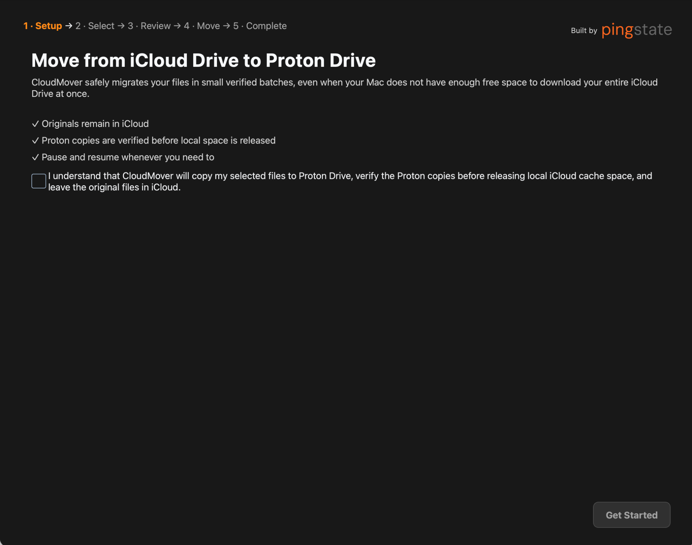
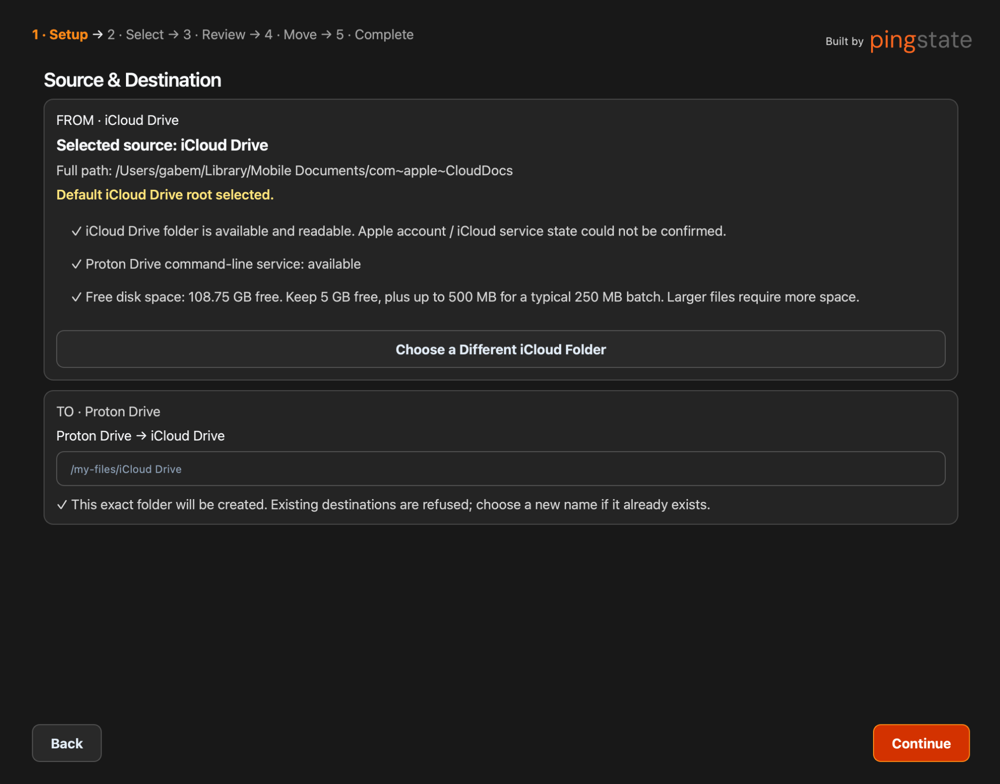
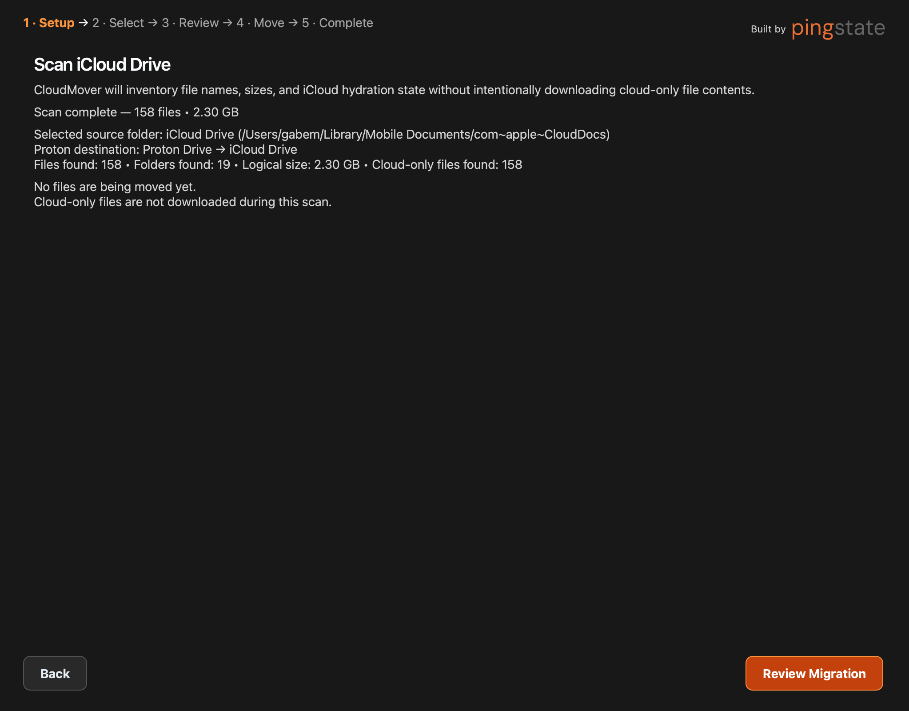
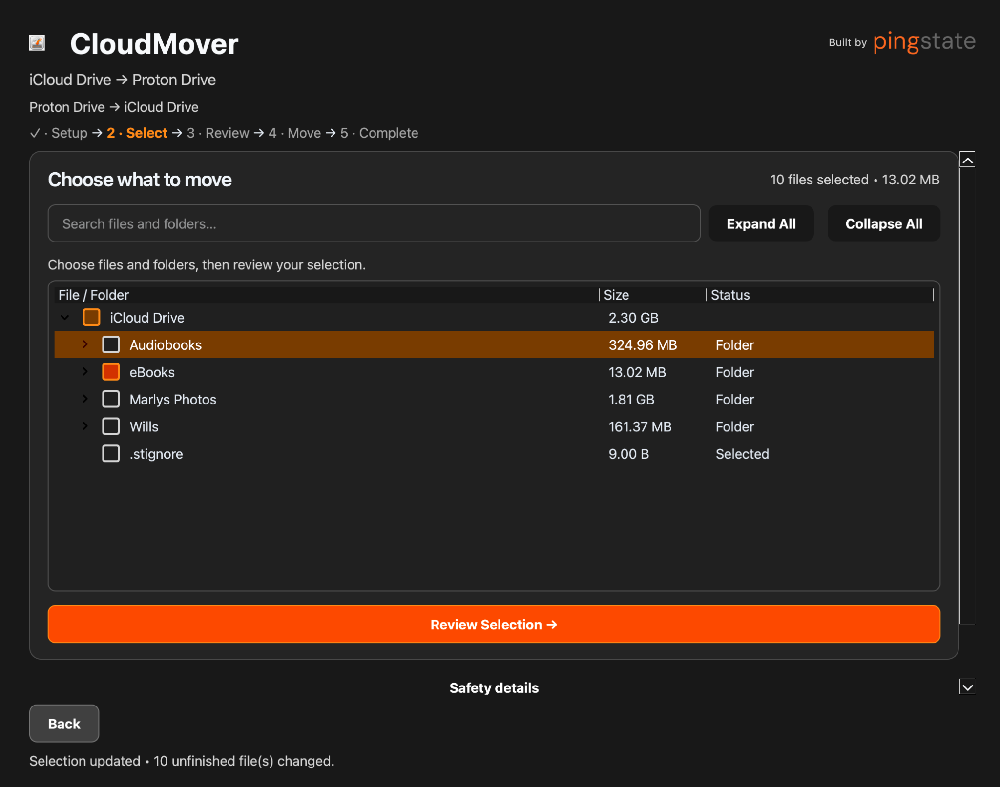
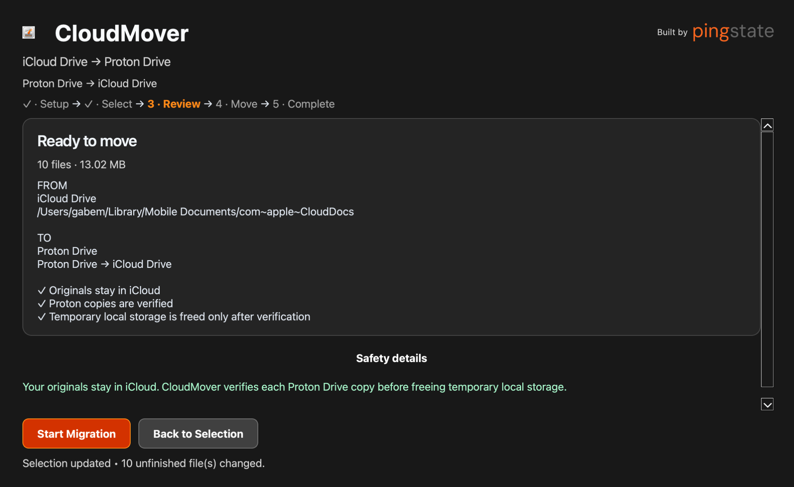
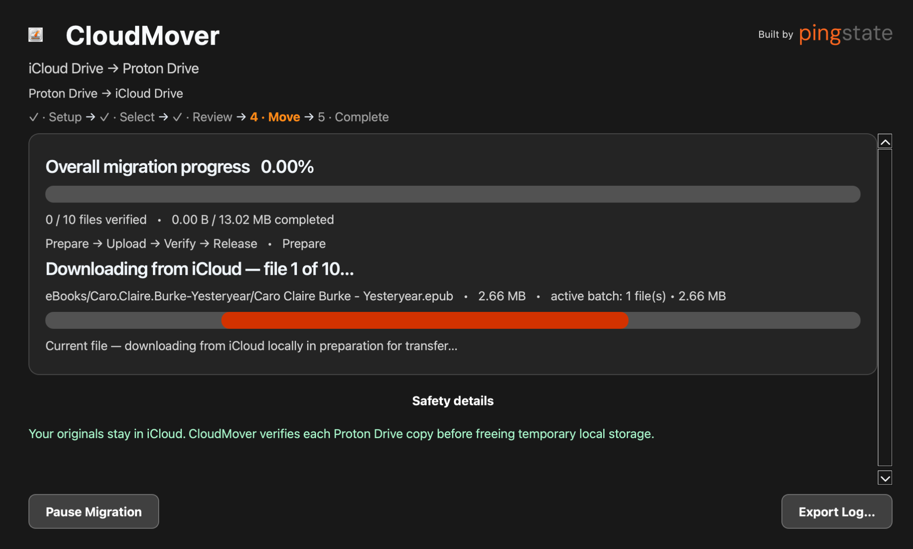
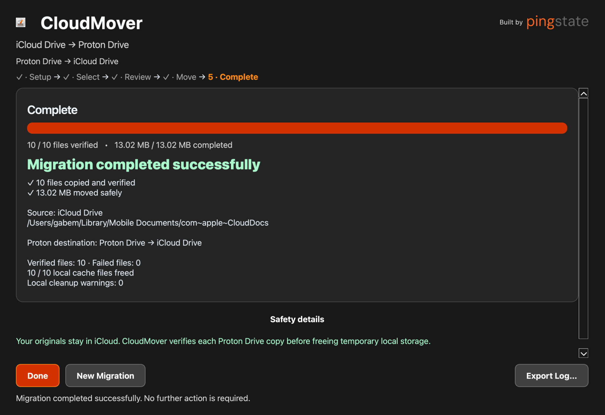

# CloudMover

**Current version: 0.20.0**

CloudMover is a macOS migration utility for safely moving files from **iCloud Drive to Proton Drive**. It handles cloud-only files, verifies Proton copies before freeing temporary local storage, supports pause/resume, and fails closed rather than overwriting uncertain destinations. **Your originals stay in iCloud.**

CloudMover is actively being developed. Version 0.20.0 is a product and usability milestone, not a production-final 1.0 release. The currently supported migration path is iCloud Drive → Proton Drive on macOS.

This repository contains the app source code, not a prebuilt `CloudMover.app`. Build the macOS app locally on your Mac using the instructions below; the generated bundle is written to `dist/CloudMover.app` and is not included in Git.

## License and project independence

CloudMover's source code is publicly viewable, but **CloudMover is not currently released as open-source software**.

Copyright © 2026 Gabe Moncada. All rights reserved.

Viewing or forking this repository on GitHub does not grant permission to redistribute, repackage, modify, sell, commercially exploit, or incorporate CloudMover into another product or service except as permitted by applicable law or GitHub's Terms of Service. See the [`LICENSE`](LICENSE) file for the complete terms.

CloudMover is an **independent community project**. It is not an official Proton product and is not affiliated with, sponsored by, or endorsed by Proton AG unless explicitly stated otherwise by Proton.

References to Proton, Proton Drive, and related products are used solely to describe compatibility and functionality. Their names, logos, and trademarks remain the property of their respective owners.

For permission to reuse or redistribute CloudMover beyond the terms above, contact the repository owner.

## Features

- **Graphical macOS interface:** Setup → Select → Review → Move → Complete, with a searchable file/folder selection tree.
- **Cloud-only file handling:** downloads selected iCloud files locally as needed, using bounded hydration and staging batches.
- **Verified transfers:** safe temporary upload → verification → promotion, with SHA-1/digest, filename, size, and Proton node/identity checks.
- **Destination protection:** new named folders or explicitly selected Proton Drive root, with collision checks and no silent merge or overwrite.
- **Pause, resume, and recovery:** durable migration history, interrupted-work recovery, and a New Migration escape path when an incomplete migration cannot continue.
- **Clear progress:** separate overall verification counts, current-file/batch activity, and actionable errors; no invented upload percentages.
- **Support diagnostics:** Export Log… saves a copy of the existing JSONL log without changing the original.
- **Verified-before-release safety:** temporary local iCloud storage is freed only after the Proton copy is verified. Local cleanup warnings remain separate from transfer failures.

## App screenshots

These screenshots show the macOS app's setup, selection, review, migration, and completion screens. Expand the section to view the full walkthrough.

<details>
<summary>View the CloudMover app walkthrough</summary>

### 1. Safety setup



### 2. Choose the source and destination



### 3. Review the scan



### 4. Select files and folders



### 5. Review the migration



### 6. Follow migration progress



### 7. Confirm completion



</details>

## What's new in 0.20.0

- Polished five-stage UI with clearer source names and friendly destinations such as **Proton Drive → Photos**.
- Packaged CloudMover app icon and subtle Pingstate creator branding.
- Improved active migration feedback, orange progress bars, and expandable safety details that scroll without squeezing status text or hiding controls.
- Destination validation **before scanning**, with inline collision messages on the editable Setup screen.
- Explicit **Proton Drive root** support while retaining folder ownership and file collision protection.
- Cleaner paused/error screens with Resume, confirmed **New Migration…**, and **Export Log…** actions. Starting a new plan preserves previous migration history and existing iCloud/Proton files.
- Selection-tree crash fix: checkbox changes persist first, then reconcile in place after the Qt event finishes.
- Packaged Proton CLI discovery for Finder launches, including `/usr/local/bin/proton-drive` and `/opt/homebrew/bin/proton-drive` alongside normal PATH lookup.
- **310 automated tests passed at release validation**, followed by manual approval of the packaged app.

Release commit: [`12cc037`](https://github.com/BringYourServerToTheSlaughter/CloudMover/commit/12cc0374e97ef5d45dc72def550479ab0d462a29) — `Release CloudMover 0.20.0`.

## Getting started

You need macOS with an available, readable iCloud Drive source and the `proton-drive` CLI installed and configured for your Proton account. The CLI is a separate prerequisite; the packaged app includes its Python migration worker but does not provision Proton CLI credentials.

Open `CloudMover.app`, then:

1. **Setup:** acknowledge the safety explanation, choose a source and destination, and complete source, CLI, free-space, and destination checks. Inventory does not intentionally download cloud-only file contents.
2. **Select:** choose files and folders using the tree, search, and expand/collapse controls.
3. **Review:** confirm the selected count, size, source, destination, and safety information. Nothing transfers until **Start Migration**.
4. **Move:** follow current activity and verification progress. Pause when needed; an already-started migration reopens here with **Resume Migration**.
5. **Complete:** review verified files and local cleanup results, then choose Done or New Migration.

An incomplete migration also offers New Migration after confirmation. This opens clean Setup without deleting old history or existing cloud files. It does not repair, recreate, or adopt a missing Proton destination to bypass a safety stop.

### Destinations

The default new destination uses the selected source folder's name. For example, selecting `SyncMeBro-2` proposes **Proton Drive → SyncMeBro-2**. A source entry `Pics/file.jpg` appears directly beneath that destination with its relative hierarchy preserved.

There is **no implicit CloudMover parent or visible migration UUID directory**. An existing user-created `CloudMover` folder is not application storage.

A new named destination must not already exist, even if empty. Setup keeps collisions beside the editable destination field and preserves your source selection. The engine checks again before transfer; a successful setup check does not reserve a remote name.

The explicit root destination (`/my-files/` in the destination editor) is a special allowed choice, displayed as **Proton Drive root**. This does not authorize merging into arbitrary existing child folders: migration-owned folders must retain their recorded identities, and existing final files remain protected. Internal paths are retained for configuration and technical/error details.

## How CloudMover protects your files

### Transfer proof before local cleanup

CloudMover uploads under isolated temporary names, verifies the temporary copies, checks the final destination for collisions immediately before promotion, and verifies the promoted result. Verification checks expected names, logical sizes, SHA-1 digests, and node identity where required by the transfer path. Missing or contradictory proof stops the operation rather than treating uncertain content as successfully migrated.

Overall completion is recorded only after the existing batch verification criteria pass. A successful temporary-upload check alone does not mark the file COMPLETE.

Local iCloud cache release requires a `COMPLETE`, verified file. CloudMover asks macOS/iCloud to free its local cached contents; it does not delete the original from iCloud. If macOS refuses cleanup, the verified Proton copy remains verified, and a separate cleanup warning is recorded. Cleanup errors do not replace the original transfer error or silently downgrade a verified transfer.

### Ownership and no-overwrite checks

When CloudMover creates a named migration destination, it records the returned Proton folder UID and path in SQLite metadata. Resume checks that identity. Root migrations likewise record ownership of their created child folders. Migration IDs remain internal identifiers, not visible directory levels.

A crash after remote creation but before ownership is saved fails closed: the orphan folder is preserved and is not automatically adopted. A missing or changed destination identity also stops work. Existing migration plans retain their stored paths; uncertain legacy roots without ownership proof are refused.

Temporary cleanup is limited to copies whose identity and verification evidence support cleanup. Uncertain copies are preserved. No automatic cleanup removes unrelated Proton content.

### Bounded disk use

The current staging target is approximately **250 MB**, with a **5 GB minimum free-space reserve**. Before hydration, CloudMover checks reserve plus hydration/staging headroom, conservatively allowing for a fallback staging copy. A typical 250 MB batch therefore needs up to 500 MB beyond the reserve. Larger files require more free space; the app stops safely when the required headroom is unavailable.

Byte-targeted scheduling resumes READY work before hydrating more PENDING files. The file-count ceiling is 5,000 so batches of small files are not needlessly tiny. These are batch controls, not promises that every selected file will fit available disk space.

### Durable state and recovery

SQLite stores migration plans, selection, per-file progress, verification results, destination ownership, and cleanup warnings. The transfer state model is:

```text
PENDING → HYDRATING/READY → UPLOADING → VERIFYING → COMPLETE
```

Failures and interruptions have explicit recovery paths. Stale HYDRATING rows recover to PENDING; UPLOADING and VERIFYING rows recover to READY for safe retry. COMPLETE rows remain preserved. Runtime process ownership determines whether the UI shows a live migration; a stale RUNNING database label does not keep the screen falsely active.

Resume recovers interrupted state and reconciles source inventory before starting the worker. Newly discovered files are added unselected; completed rows remain migration history. Deselected files are excluded from scheduling and local release. Closing the app stops its associated engine; Proton child processes share the worker's process group so pause/close can reach them.

New inventories exclude the regular macOS `.DS_Store` metadata file, including nested occurrences. Other dotfiles remain eligible; previously uploaded metadata copies are not deleted.

## Progress, cancellation, and diagnostics

Overall verified files/bytes are separate from current-file hydration and current-batch activity. Measured progress is determinate when available; opaque Proton operations use an activity indicator. Verification counters may describe folder groups rather than individual files. **Finalizing** is not a claim of completion.

Migration speed depends on internet connectivity, especially upload speed, file sizes, file count, and provider/API overhead. Many small files may take longer than fewer large files of the same total size.

Scan cancellation is cooperative. Cancel immediately shows **Cancelling scan…** and disables navigation until the worker exits. Cancellation checks surround enumeration, metadata inspection, and inventory persistence; cancelled inventory rolls back its transaction. An individual synchronous macOS/iCloud filesystem call cannot itself be interrupted, so cancellation may wait for that call to return. Source checks establish folder availability/readability without claiming certainty about Apple account service state.

Runtime data defaults to:

```text
~/Library/Application Support/CloudMover/
  migration.db
  cloudmover.jsonl
  migration.selection.jsonl
```

**Export Log…** copies the full `cloudmover.jsonl` through a save dialog. Logs can contain filenames and paths; the export is **not anonymized**. Fatal migration errors appear in the stopped/needs-attention UI, with raw diagnostics behind Show error details.

Migration lifecycle and transfer events carry `migration_id`. Bounded `safe_upload_stage` events record phases such as destination preflight, CLI upload, temporary verification, rename/promotion, and final verification, with durations and status. CLI timing includes process startup, authentication, API, and network work; it does not independently measure network bandwidth. Selection diagnostics use a separate sibling JSONL file and aggregate reconciliation events rather than logging every tree row.

## Technical reference

### Proton CLI boundaries

CloudMover invokes Proton commands using argument arrays, never `shell=True`. Spaces, apostrophes, parentheses, hyphens, and Unicode remain within their original path/name argument.

| Operation | Argument contract |
| --- | --- |
| Create folder | `filesystem create-folder parentPath name`; parent must already exist |
| List / verification listing | One complete remote path after list options |
| Info / exact verification | One complete remote path; `-j` enables JSON output |
| Temporary upload | Local path(s), followed by one complete remote parent path |
| Rename / promotion | One complete temporary remote path, one complete final name |
| Temporary trash cleanup | Verified temporary node UID path |

Authentication/network errors do not authorize folder creation. Final collision checks are not replaced by cached directory information. Grouped verification reduces repeated provider calls while retaining per-file proof; exact-parent or exact-file checks remain available when a broader listing lacks the required evidence.

### Development and local builds

The source project requires macOS 13 or later and Python 3.11+. The GUI uses PySide6. To create the app bundle, install PyInstaller and pytest in the same Python environment. The repository does not include a prebuilt app, and the bundle is created on your Mac.

```bash
# Open the GUI from the repository
python3 -m src.cloudmover.gui

# Inventory a source without intentionally hydrating file contents
python3 -m src.cloudmover.scanner "$HOME/Library/Mobile Documents/com~apple~CloudDocs"

# Inspect saved migration state
python3 -m src.cloudmover.state status --db "$HOME/Library/Application Support/CloudMover/migration.db"
```

The component CLI entry points remain useful for controlled development. Use their `--help` output for current options; prefer the GUI setup flow for a normal migration. Historical trial commands and test destinations are not the current product workflow.

To create and run the macOS app from a fresh checkout, open Terminal in the repository and run:

```bash
python3 -m venv .venv
source .venv/bin/activate
python -m pip install --upgrade pip
python -m pip install -e '.[gui]' pytest pyinstaller
./scripts/build_macos_app.sh
open dist/CloudMover.app
```

The build script runs the automated test suite before packaging and creates `dist/CloudMover.app` locally. You can also run `make app` to build and `make open-app` to launch the bundle after it has been built.

Local builds use an ad-hoc signature; they are not Developer ID signed or notarized distribution builds. The packaged worker runs inside the bundled executable and does not need an external Python interpreter. Runtime locations can be changed with `CLOUDMOVER_APP_SUPPORT`; development entry points also support explicit database/log options where applicable.

### Project layout and further reading

- `src/cloudmover/` — migration state, engine, GUI, and supporting utilities
- `src/cloudmover/providers/` — iCloud and Proton adapters
- `tests/` — safety, engine, setup, GUI, and packaging regression coverage
- `assets/` — CloudMover and Pingstate artwork
- `docs/` — architecture, investigations, and development plans

Implementation notes: [destination preflight](docs/setup-destination-gate.md), [selection-tree stability](docs/selection-tree-stability.md), [grouped verification and performance](docs/performance-grouped-proof.md), and [performance investigation](docs/performance-investigation.md). These notes document individual development passes; their historical versions and test counts are not the current release status. The [roadmap](docs/ROADMAP.md) and [product specification](docs/V1_SPEC.md) describe plans, not additional currently supported providers.

## Earlier milestones

- **0.1–0.3:** source scanning, hydration-state inventory, and durable SQLite manifests.
- **0.16.4 development series:** single-file hydration and upload trials grew into hierarchy-preserving transfers, grouped verification, resumable staging, protected disk reserves, diagnostics, and the first Qt interface.
- **0.19.6:** graphical selection and migration controls, first-run setup, packaged worker/app support, adaptive batching, inventory reconciliation, and authoritative pause/resume state.
- **0.20.0:** the current five-stage product experience, safer setup and destination handling, clearer recovery/support actions, and stability improvements described above.

Earlier experimental defaults—trial destination wrappers, hydration-only operation, read-only GUI controls, and fixed 20 GB reserves—do not describe the current release. Git history retains those development steps.
